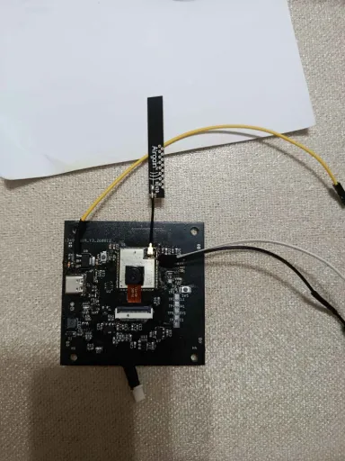
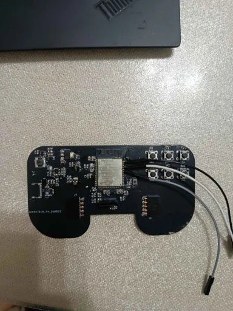

# ESP32-S3 Drone

以 **ESP32-S3** 為核心的四軸無人機專案，包含 4 層飛控板、手把式遙控器電路板，以及以 PlatformIO 建置的韌體。




## 專案狀態

| 項目 | 狀態 |
| --- | --- |
| 飛控板（4 層 PCB） | ✅ 設計完成，Gerber 已輸出 |
| 遙控器 PCB | ✅ 設計完成，Gerber 已輸出 |
| 韌體 | 🚧 僅完成硬體 bring-up 測試 |
| 飛行控制 | ⛔ 尚未實作 |

> `src/main.cpp` 目前只會透過序列埠輸出晶片資訊、讀取 GPIO 32，並每秒印出一個 `.`。
> PID、姿態解算、馬達混控、無線遙控與 failsafe 都還未加入，請不要把目前的韌體當成可飛行的飛控。

## 硬體

| 項目 | 內容 |
| --- | --- |
| MCU | ESP32-S3（DevKitC-1 腳位） |
| 感測器 | MPU-6050（六軸 IMU）、BMP3XX 系列氣壓計 |
| Flash | 16 MB |
| 無線 | Wi-Fi 2.4 GHz、Bluetooth 5 (LE) |
| 框架 | Arduino / PlatformIO |
| 硬體設計 | KiCad：飛控板 + 手把式遙控器 |

感測器型號來自 `platformio.ini` 的 `lib_deps`；實際焊接型號、I2C 位址與腳位請以 PCB 和 BOM 為準。

### 電路板與 Gerber

- `esp32_drone_4layerVersion/` — 飛控主板，4 層板。內含 KiCad 原理圖、PCB、netlist、CAM 子圖與 `ESP_drone_gerber/`。
- `esp32_drone_controller/` — 手把式遙控器板。內含 KiCad 原理圖、PCB、netlist、自訂 `touch_pad.pretty` 封裝與 `controller_gerber/`。
- `Image/` — 實板照片。

用 KiCad 開啟各目錄下的 `.kicad_pro` 即可編輯；`*_gerber/` 內是可直接送廠的 Gerber/鑽孔檔。

## 目錄結構

```text
ESP_drone/
├── src/main.cpp                  # 目前唯一的應用程式進入點
├── include/                      # 專案標頭（目前為 PlatformIO 預設說明）
├── lib/                          # 私有函式庫（目前為 PlatformIO 預設說明）
├── test/                         # 測試（目前為 PlatformIO 預設說明）
├── esp32_drone_4layerVersion/    # 飛控板 KiCad + Gerber
├── esp32_drone_controller/       # 遙控器 KiCad + Gerber
├── Image/                        # 實板照片
├── platformio.ini                # PlatformIO 環境設定
├── sdkconfig.defaults            # ESP-IDF 預設設定
└── .gitignore
```

## 開發環境

需要 **VS Code + PlatformIO IDE**，或獨立的 **PlatformIO Core**：

```bash
pip install platformio
```

### 建置與燒錄

```bash
# 建置
pio run

# 燒錄（自動選擇序列埠）
pio run --target upload

# 看序列埠輸出
pio device monitor --baud 115200
```

如果電腦接有多個序列裝置，請明確指定埠：

```bash
pio run --target upload --upload-port COM5
pio device monitor --port COM5 --baud 115200
```

### 設定重點

`platformio.ini` 目前的使用設定：

| 設定 | 值 | 說明 |
| --- | --- | --- |
| `platform` | `espressif32@6.5.0` | 固定版本，避免平台更新造成差異 |
| `board` | `esp32-s3-devkitc-1` | ESP32-S3 DevKitC-1 |
| `framework` | `arduino` | Arduino-ESP32 |
| `board_upload.flash_size` | `16MB` | 對應 16 MB Flash 的板子 |
| `board_build.partitions` | `default_16MB.csv` | 16 MB 分區表 |
| `board_build.flash_mode` | `dio` | 使用 DIO，而非 QIO/OPI |
| PSRAM | 關閉 | `board_build.psram = disabled`、`BOARD_HAS_PSRAM=0` |
| USB CDC | 關閉 | `ARDUINO_USB_MODE=0`、`ARDUINO_USB_CDC_ON_BOOT=0` |
| 除錯等級 | `CORE_DEBUG_LEVEL=5` | 開發期詳細 log；量產可調低 |

`sdkconfig.defaults` 另外固定了：

```text
CONFIG_SPIRAM=n
CONFIG_ESP32S3_DEFAULT_CPU_FREQ_240=y
CONFIG_ESPTOOLPY_FLASHMODE_DIO=y
CONFIG_ESPTOOLPY_FLASHFREQ_80M=y
```

> 如果你的板子不是 16 MB Flash，請先改 `board_upload.flash_size` 與分區表，否則燒錄後可能無法正常啟動。

## 預期的 bring-up 輸出

燒錄後開啟 115200 序列埠，應該會看到類似：

```text
===============================
 ESP32-S3 Basic Test
===============================
Free Heap: 123456 bytes
Chip Revision: 0
CPU Frequency: 240 MHz
GPIO 32 state: 1
System is stable!
.
.
```

這段程式只驗證三件事：序列埠、晶片基本資訊、GPIO 32 輸入。它不代表 IMU、氣壓計、馬達或無線功能已經驗證。

## 開發路線圖

- [x] 4 層飛控板設計與 Gerber 輸出
- [x] 手把式遙控器板設計與 Gerber 輸出
- [x] PlatformIO 專案與 ESP32-S3 bring-up
- [ ] MPU-6050 初始化、校正與姿態解算
- [ ] BMP3XX 氣壓／高度讀取
- [ ] PID 控制器與馬達混控
- [ ] 遙控器無線協定（Wi-Fi / BLE / 2.4 GHz）
- [ ] Failsafe、低電壓保護與解鎖邏輯
- [ ] 室內懸停測試與戶外飛行測試
- [ ] 遙測與地面站

## 疑難排解

| 問題 | 建議 |
| --- | --- |
| 找不到序列埠 | 確認 USB 線可傳資料（不是純充電線）、安裝 CP210x/CH340 驅動，或換一個 USB 埠 |
| 燒錄失敗 | 按住 BOOT 再按 RESET 進入下載模式；必要時把 `upload_speed` 降到 `460800` |
| 開序列埠沒有輸出 | 此專案關閉了 USB CDC，請接 UART 腳位（TX/RX）並以 115200 開啟 |
| 一直重啟 | 檢查供電是否足夠、Flash 大小與分區表是否匹配 |
| PSRAM 相關錯誤 | 本專案刻意關閉 PSRAM；除非板子確定有 PSRAM，否則不要開啟 |

## 版本控制說明

`.gitignore` 已排除下列本機產生內容：

- `.pio/` — PlatformIO 建置快取與下載的套件（可達數十 MB）
- `.history/` — VS Code Local History，會保存大量檔案快照
- `.vscode/c_cpp_properties.json`、`.vscode/launch.json`、`.vscode/ipch/` — 由 PlatformIO 產生，內含本機絕對路徑
- `sdkconfig`、`build/`、`*.bin`、`*.elf`、`*.map` — 建置產物
- `*.kicad_prl`、`fp-info-cache`、`_autosave-*`、`*-backups/` — KiCad 本機設定與自動備份

KiCad 的 `.kicad_pro`、`.kicad_pcb`、`.kicad_sch`、`.net`、Gerber 與 `.zip` **不會**被忽略，會正常納入版控。

## 授權

本專案目前未附 `LICENSE`。
